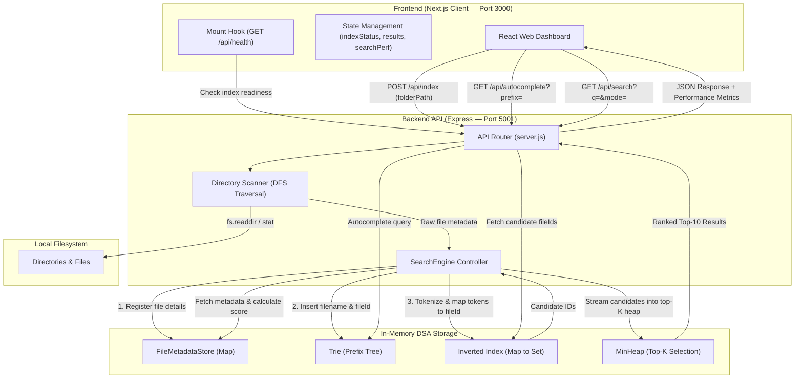

# SmartFind — Smart File Search Engine

> A high-performance, local file search engine powered by custom Data Structures and Algorithms (Trie, Inverted Index, Min-Heap, and HashMap Metadata Store) paired with a responsive Next.js web interface and an Express.js backend.

---

## Table of Contents

- [1. Project Overview](#1-project-overview)
- [2. Key Features](#2-key-features)
- [3. Tech Stack](#3-tech-stack)
- [4. DSA Concepts & Complexity Analysis](#4-dsa-concepts--complexity-analysis)
- [5. System Architecture](#5-system-architecture)
- [6. Project Directory Structure](#6-project-directory-structure)
- [7. Installation and Setup](#7-installation-and-setup)
- [8. How to Use SmartFind](#8-how-to-use-smartfind)
- [9. REST API Documentation](#9-rest-api-documentation)
- [10. Performance Benchmarking](#10-performance-benchmarking)
- [11. Testing & Validation](#11-testing--validation)
- [12. Limitations & Future Roadmap](#12-limitations--future-roadmap)
- [13. User Interface Screenshots](#13-user-interface-screenshots)
- [14. Learning Outcomes](#14-learning-outcomes)
- [15. Contributing](#15-contributing)
- [16. License](#16-license)

---

## 1. Project Overview

Finding files on personal workstations and servers often relies on linear filesystem scans (such as standard OS searches or naive recursion). As directories grow to contain tens or hundreds of thousands of files, linear scanning incurs significant search latency ($O(N)$), high disk I/O, and unranked results.

**SmartFind** solves this problem by decoupling file discovery from search execution:
1. **Index Construction**: A recursive directory scanner traverses a designated folder once, storing file details in memory and building custom in-memory index data structures.
2. **Instant Retrieval**: Autocomplete requests are served by a **Trie (Prefix Tree)** in $O(P + M)$ time. Multi-word keyword queries are resolved by an **Inverted Index** in $O(1)$ average dictionary lookup time.
3. **Relevance Ranking**: Candidate files are scored using multi-factor relevance heuristics and ranked using a bounded **Min-Heap**, delivering the top-$K$ most relevant results in $O(M \log K)$ time without sorting the entire dataset.

---

## 2. Key Features

- **Recursive Directory Scanning**: Depth-First Search traversal that automatically skips large dependency and system directories (`node_modules`, `.git`, `.next`, `dist`, `build`, etc.) to prevent memory exhaustion.
- **Trie-Based Autocomplete**: Instant sub-millisecond prefix suggestions as the user types into the search bar, with keyboard arrow navigation.
- **Multi-Word Keyword Search**: Full tokenization of filenames with support for both **AND** (set intersection) and **OR** (set union) matching modes.
- **Relevance Scoring Engine**: Multi-tiered heuristic scoring evaluating exact basename matches (+100), exact phrase matches (+70), token matches (+20/+10), complete query term coverage (+30), and length-based tie-breakers.
- **Top-$K$ Min-Heap Selection**: Extracts the highest-scoring files using a bounded Min-Heap of capacity $K=10$, avoiding full $O(M \log M)$ array sorting.
- **Real-Time Performance Comparison**: Executes an indexed search and a baseline linear scan in parallel for every query, reporting live execution times (ms) and match counts.
- **Persistent Index State Lifecycle**: Sidebar indicator dynamically reflects real indexing states (`Indexing...`, `Index ready`, `Index not built yet`, or error) synchronized with backend health checks.
- **Responsive Web Dashboard**: Clean interface built with Next.js and React, featuring file type badges (`TS`, `JS`, `PY`, `PDF`, `MD`, etc.), match percentage scores, one-click path copying, and search query highlighting.

---

## 3. Tech Stack

- **Frontend**: Next.js 16 (App Router, Turbopack), React 19, Vanilla CSS (custom design system)
- **Backend**: Node.js, Express 5, CORS
- **Language**: JavaScript (ES Modules, modern ES2024 features)
- **Data Structures**: Trie (Prefix Tree), Inverted Index (Hash Map to Set), Bounded Min-Heap (Binary Heap), HashMap FileMetadata Store
- **System Utilities**: Node.js `fs.promises`, `node:perf_hooks` for sub-millisecond benchmarking

---

## 4. DSA Concepts & Complexity Analysis

| Data Structure / Algorithm | Role in SmartFind | Why It Is Appropriate | Time Complexity | Space Complexity | File Location |
| :--- | :--- | :--- | :--- | :--- | :--- |
| **Trie (Prefix Tree)** | Filename prefix search & autocomplete | Maps shared prefixes along tree branches; avoids scanning non-matching words. Uses `Map<char, TrieNode>` to support dots, underscores, hyphens, and spaces. | **Insert**: $O(L)$<br>**Prefix Search**: $O(P + M)$<br>*(where $L$ = name length, $P$ = prefix length, $M$ = matches)* | $O(\Sigma \cdot L \cdot N)$ (compressed by shared prefixes) | [`dsa/Trie.js`](file:///d:/SmartFileSearch/smart-file-search/dsa/Trie.js) |
| **Inverted Index** | Keyword-to-document mapping | Maps normalized word tokens to a Posting Set of compact File IDs (`Map<string, Set<string>>`). Enables instant retrieval of all matching documents. | **Add**: $O(T)$ tokens<br>**Single Search**: $O(1)$ avg<br>**AND Search**: $O(\min(\|P_1\|, \|P_2\|))$ | $O(V + P)$<br>*(where $V$ = unique vocabulary, $P$ = total postings)* | [`dsa/InvertedIndex.js`](file:///d:/SmartFileSearch/smart-file-search/dsa/InvertedIndex.js) |
| **Bounded Min-Heap** | Top-$K$ search result ranking | Maintains the top $K=10$ highest scores from $M$ matching candidates. The root holds the minimum of the top-10; new candidates replace the root only if their score is higher. | **Insertion**: $O(\log K)$<br>**Selection**: $O(M \log K)$<br>*(vs $O(M \log M)$ full sort)* | $O(K)$ auxiliary memory | [`dsa/MinHeap.js`](file:///d:/SmartFileSearch/smart-file-search/dsa/MinHeap.js) |
| **FileMetadataStore (HashMap)** | $O(1)$ file details lookup | Stores complete file attributes (`path`, `size`, `modifiedAt`, `ext`) keyed by short IDs (`F1`, `F2`). Keeps Trie and Inverted Index memory footprint minimal. | **Insert**: $O(1)$ avg<br>**Lookup**: $O(1)$ avg<br>**Delete**: $O(1)$ avg | $O(N)$<br>*(where $N$ = total files indexed)* | [`dsa/FileMetadata.js`](file:///d:/SmartFileSearch/smart-file-search/dsa/FileMetadata.js) |
| **Recursive Depth-First Traversal** | Filesystem folder scanner | Traverses directory trees depth-first using `fs.promises.readdir` while respecting ignored directories and maximum file thresholds. | **Traversal**: $O(N + D)$<br>*(where $N$ = files, $D$ = directories)* | $O(H)$ recursion stack<br>*(where $H$ = max directory depth)* | [`backend/scanner.js`](file:///d:/SmartFileSearch/smart-file-search/backend/scanner.js) |

---

## 5. System Architecture



---

## 6. Project Directory Structure

```
smart-file-search/
├── backend/
│   ├── benchmark.js          # Standalone benchmark comparing Linear Scan vs Indexed Search (100k files)
│   ├── scanner.js            # Recursive directory scanner with DFS and ignore-list filtering
│   ├── searchEngine.js       # Core engine coordinating Trie, Inverted Index, MinHeap, and scoring
│   ├── server.js             # Express API server exposing REST endpoints on port 5001
│   ├── testScanner.js        # Test suite for folder scanning and indexing integration
│   └── testSearchEngine.js   # End-to-end test suite for autocomplete, search, and stats
├── dsa/
│   ├── FileMetadata.js       # HashMap-based store for fast O(1) file attribute lookup
│   ├── InvertedIndex.js      # Inverted index data structure with AND/OR multi-word support
│   ├── MinHeap.js            # Custom binary Min-Heap with bubble-up, bubble-down, and top-K extraction
│   ├── Trie.js               # Prefix Tree implementation for fast prefix search and autocomplete
│   ├── testInvertedIndex.js  # Unit tests for Inverted Index insertion, search, and document removal
│   ├── testMetadata.js       # Unit tests for FileMetadataStore operations
│   ├── testMinHeap.js        # Unit tests for MinHeap bounded top-K selection
│   └── testTrie.js           # Unit tests for Trie prefix and exact match searches
├── public/
│   ├── file.svg              # Fallback file icon
│   └── icon.svg              # SmartFind custom browser favicon
├── src/
│   └── app/
│       ├── globals.css       # Design tokens, color system, and status-pulse animation
│       ├── layout.js         # Root layout with Geist font and SmartFind metadata
│       ├── page.js           # Main application dashboard (search, tabs, performance metrics)
│       └── icon.svg          # Next.js App Router brand icon
├── package.json              # Project dependencies, scripts, and configuration
├── next.config.mjs           # Next.js configuration (Turbopack, compiler, devIndicators)
└── README.md                 # Complete project documentation
```

---

## 7. Installation and Setup

### Prerequisites
- **Node.js**: v18.17.0 or later (Node.js 20+ recommended)
- **npm**: v9.0.0 or later

### Step 1: Clone the Repository
```bash
git clone https://github.com/antrasharma15/SmartFileSearchEngine.git
cd SmartFileSearchEngine
```

### Step 2: Install Dependencies
Install dependencies from the repository root:
```bash
npm install
```

### Step 3: Run the Application

SmartFind consists of two services: the **Express Backend (Port 5001)** and the **Next.js Frontend (Port 3000)**. They should be launched in separate terminal windows.

#### Terminal 1 — Start the Backend Server:
```bash
npm run server
```
*Alternatively, you can run directly:*
```bash
node backend/server.js
```
*Expected output:*
```
Search API running at http://localhost:5001
```

#### Terminal 2 — Start the Next.js Frontend:
```bash
npm run dev
```
*Expected output:*
```
▲ Next.js 16.4.0 (Turbopack)
- Local: http://localhost:3000
✓ Ready in 1.2s
```

Open your browser and navigate to **`http://localhost:3000`**.

---

## 8. How to Use SmartFind

1. **Select and Index a Folder**:
   - In the top action bar, click **Choose Folder** or click the folder input.
   - Enter a local directory path (e.g., `.` for the current project root, or an absolute folder path).
   - Click **Save & Index**. The backend scans files recursively, registers metadata, and constructs the Trie and Inverted Index.
   - The bottom-left status card will display a green indicator with the total indexed file count (e.g., `43 files indexed (Index ready)`).

2. **Trie Autocomplete**:
   - Click the search input or press `Ctrl + K` (`Cmd + K` on macOS).
   - Begin typing a filename prefix (e.g., `sea`).
   - A dropdown menu displays instant prefix matches retrieved from the Trie. Press `Enter` or click a suggestion to search immediately.

3. **Keyword Search (AND / OR Modes)**:
   - Type one or more keywords into the search box (e.g., `search engine`).
   - Select **AND** to match files containing all query terms (set intersection).
   - Select **OR** to match files containing any query term (set union).
   - Click **Search →** or press `Enter`. Results display with filename badges, matched keyword highlights, file sizes, relative dates, and relevance scores.

4. **Inspect Performance & Algorithm Comparisons**:
   - Scroll down on the Search tab or switch to the **Performance** tab in the left navigation sidebar.
   - Inspect live execution metrics:
     - **Folder Scan Time**: Time spent traversing disk with `fs.promises.readdir`.
     - **Index Construction**: Time taken to build the Trie, Inverted Index, and FileMetadata map.
     - **Search Execution**: Sub-millisecond time to query the Inverted Index and select the top-$K$ results via the Min-Heap.
     - **Side-by-Side Algorithm Comparison**: Compares the live Inverted Index query against a baseline linear array scan for the same search term.

---

## 9. REST API Documentation

Base URL: `http://localhost:5001`

### 1. Root Service Discovery
- **Endpoint**: `GET /`
- **Purpose**: Verifies that the API service is active and lists available endpoints.
- **Response `(200 OK)`**:
  ```json
  {
    "status": "ok",
    "message": "Smart File Search API is running",
    "endpoints": {
      "health": "/api/health",
      "search": "/api/search?q=<query>",
      "autocomplete": "/api/autocomplete?prefix=<prefix>",
      "index": "POST /api/index"
    }
  }
  ```

---

### 2. Health & Index State Check
- **Endpoint**: `GET /api/health`
- **Purpose**: Checks server health and returns the active indexing status, scanned folder path, file count, and timing stats.
- **Response `(200 OK — When Indexed)`**:
  ```json
  {
    "status": "ok",
    "message": "Search API is healthy",
    "indexed": true,
    "folderPath": ".",
    "totalFiles": 43,
    "scanTimeMs": 2.15,
    "indexTimeMs": 0.82,
    "stats": {
      "totalFiles": 43,
      "vocabularySize": 64,
      "totalPostings": 98,
      "indexedDocuments": 43
    }
  }
  ```

---

### 3. Build / Rebuild Index
- **Endpoint**: `POST /api/index`
- **Purpose**: Recursively scans the target folder and constructs the in-memory Trie, Inverted Index, and FileMetadata store.
- **Request Headers**: `Content-Type: application/json`
- **Request Body**:
  ```json
  {
    "folderPath": "."
  }
  ```
- **Response `(200 OK)`**:
  ```json
  {
    "message": "Folder indexed successfully!",
    "totalFiles": 43,
    "scanTimeMs": 2.15,
    "indexTimeMs": 0.82,
    "indexStats": {
      "totalFiles": 43,
      "indexedTerms": 64,
      "trieWords": 42
    },
    "stats": {
      "totalFiles": 43,
      "indexedTerms": 64,
      "trieWords": 42
    }
  }
  ```
- **Error Response `(400 Bad Request)`**:
  ```json
  {
    "error": "Please provide a folder path."
  }
  ```

---

### 4. Search Files
- **Endpoint**: `GET /api/search`
- **Purpose**: Searches indexed files using the Inverted Index, scores matching candidates, extracts top-$K$ results via the Min-Heap, and compares against a linear search baseline.
- **Query Parameters**:
  - `q` *(string, required)*: The search query (e.g., `search engine`).
  - `limit` *(number, optional)*: Maximum results to return (default: `10`).
  - `mode` *(string, optional)*: Keyword matching mode: `"AND"` or `"OR"` (default: `"AND"`).
- **Response `(200 OK)`**:
  ```json
  {
    "query": "search",
    "totalMatches": 2,
    "searchTimeMs": 0.57,
    "results": [
      {
        "id": "F3",
        "name": "searchEngine.js",
        "baseName": "searchEngine",
        "extension": ".js",
        "path": "D:\\SmartFileSearch\\smart-file-search\\backend\\searchEngine.js",
        "size": 7197,
        "modifiedAt": "2026-10-15T13:13:58.289Z",
        "score": 80.07
      },
      {
        "id": "F6",
        "name": "testSearchEngine.js",
        "baseName": "testSearchEngine",
        "extension": ".js",
        "path": "D:\\SmartFileSearch\\smart-file-search\\backend\\testSearchEngine.js",
        "size": 1008,
        "modifiedAt": "2026-10-13T13:35:46.956Z",
        "score": 80.05
      }
    ],
    "indexed": true,
    "totalFiles": 43,
    "linearSearchTimeMs": 0.055,
    "linearTotalMatches": 0
  }
  ```
- **Error Response `(400 Bad Request — When Index Not Built)`**:
  ```json
  {
    "indexed": false,
    "error": "Please index a folder first by clicking 'Index Folder'!"
  }
  ```

---

### 5. Filename Autocomplete
- **Endpoint**: `GET /api/autocomplete`
- **Purpose**: Retrieves instant filename suggestions matching a prefix using the Trie.
- **Query Parameters**:
  - `prefix` *(string, required)*: Search prefix (e.g., `sea`).
  - `limit` *(number, optional)*: Maximum suggestions (default: `10`).
- **Response `(200 OK)`**:
  ```json
  [
    "searchEngine.js",
    "testSearchEngine.js"
  ]
  ```

---

## 10. Performance Benchmarking

### Methodology
SmartFind includes a dedicated automated benchmark script in [`backend/benchmark.js`](file:///d:/SmartFileSearch/smart-file-search/backend/benchmark.js) to evaluate the real-world performance characteristics of **Linear Array Search** vs. **Indexed Search (Inverted Index + Min-Heap)** under identical conditions.

- **Synthetic Dataset Size**: 100,000 files
- **Number of Benchmark Runs**: 10 runs per query (after 3 warmup iterations)
- **Metric**: Median execution time (ms) calculated using `performance.now()`
- **Result Selection**: Top $K=10$ results

### Reproducible Benchmark Results (100,000 Files)
Run the benchmark directly from the repository root:
```bash
node backend/benchmark.js
```

Actual execution results:

| Query | Matches in 100k Files | Match Density | Linear Search Median | Indexed Search Median | Speedup / Trade-off | Parity Check |
| :--- | :--- | :--- | :--- | :--- | :--- | :--- |
| `quantum` | 10 | **0.01% (Highly Selective)** | 5.302 ms | **0.088 ms** | **60.46x Faster** | `true` (10/10) |
| `java` | 10,000 | **10.0% (Moderate Density)** | 5.793 ms | 21.782 ms | 0.27x *(scoring overhead)* | `true` (10k/10k) |
| `document` | 89,990 | **89.99% (Dense / Stopword-like)** | 7.318 ms | 183.386 ms | 0.04x *(scoring overhead)* | `true` (89.9k/89.9k) |

### Engineering Insight & Analysis
1. **Selective Queries ($M \ll N$)**: For targeted queries like `quantum` where matching documents represent a small subset of the collection, the Inverted Index bypasses 99.99% of non-matching files immediately via $O(1)$ set lookup, achieving a **~60x speedup** (sub-0.1 ms response time).
2. **Dense Queries ($M \approx N$)**: When a keyword matches nearly every file in the dataset (like `document` matching 90,000 files), the Inverted Index posting list contains nearly all file IDs. The indexed search performs comprehensive relevance scoring (calculating token matches, length normalization, and heap adjustments) for all 89,990 candidate objects, whereas the raw linear search merely runs a raw substring check without scoring or ranking.
3. **Conclusion**: Indexed search is optimized for selective and realistic queries where relevance ranking and sub-millisecond retrieval are paramount.

---

## 11. Testing & Validation

All modules include standalone unit test files that can be run directly using Node.js:

```bash
# 1. Test Trie prefix and exact match operations
node dsa/testTrie.js

# 2. Test Inverted Index tokenization, search, and document removal
node dsa/testInvertedIndex.js

# 3. Test Bounded Min-Heap top-K result selection
node dsa/testMinHeap.js

# 4. Test FileMetadataStore map operations
node dsa/testMetadata.js

# 5. Test Recursive Directory Scanner and index building
node backend/testScanner.js

# 6. Test End-to-End Search Engine (search, autocomplete, stats)
node backend/testSearchEngine.js

# 7. Run 100,000 File Benchmark Comparison
node backend/benchmark.js

# 8. Verify Next.js Production Compilation
npm run build
```

---

## 12. Limitations & Future Roadmap

### Current Limitations
- **In-Memory Storage**: Indexes and file metadata reside in Node.js heap memory. If the backend process terminates or restarts, the folder must be re-indexed.
- **Filename-Only Indexing**: The current engine indexes filenames and extensions. It does not parse or index the internal text content of binary files or documents (e.g., inside `.docx` or `.pdf`).
- **Single-Machine Local Scope**: Designed for local workstation file discovery; does not currently index remote network shares or distributed storage.

### Future Roadmap
- [ ] **Disk Persistence**: Persist the Trie and Inverted Index to disk using SQLite or serialized binary format for instant startup without rescanning.
- [ ] **File Content Indexing**: Extend the Inverted Index to tokenize text contents of code, markdown, and plain-text files.
- [ ] **Filesystem Watcher**: Integrate Node.js `fs.watch` to update the Inverted Index and Trie incrementally when files are created, renamed, or deleted.
- [ ] **Fuzzy Search**: Implement Levenshtein Distance / Damerau-Levenshtein in the Trie to tolerate typos during search.

---

## 13. User Interface Screenshots

*(Screenshots can be added here by placing image files in the `docs/` folder and referencing them below)*

```
docs/
├── screenshot-search.png
├── screenshot-autocomplete.png
└── screenshot-performance.png
```

---

## 14. Learning Outcomes

This project demonstrates practical implementations of fundamental computer science concepts:
1. **Tree Data Structures**: Multi-way Trie node hierarchy using HashMaps for character branch compression.
2. **Inverted Index Design**: Information retrieval concepts used in modern search engines (Lucene, Elasticsearch).
3. **Heap Algorithms**: Selection problem reduction from $O(M \log M)$ to $O(M \log K)$ via a bounded Min-Heap.
4. **Time & Space Trade-offs**: Empirical evaluation of in-memory caching vs. disk I/O and linear scans.
5. **Full-Stack Systems Integration**: Connecting low-level algorithmic modules with a modern React/Next.js interface via clean REST APIs.

---

## 15. Contributing

Contributions, bug reports, and improvements are welcome:
1. Fork the repository.
2. Create a feature branch: `git checkout -b feature/your-feature-name`.
3. Commit your changes: `git commit -m "Add feature description"`.
4. Push to your branch: `git push origin feature/your-feature-name`.
5. Open a Pull Request.

---

## 16. License

This project does not currently have a dedicated open-source license file. A license (e.g., MIT, Apache 2.0) can be added separately by the project owner.
